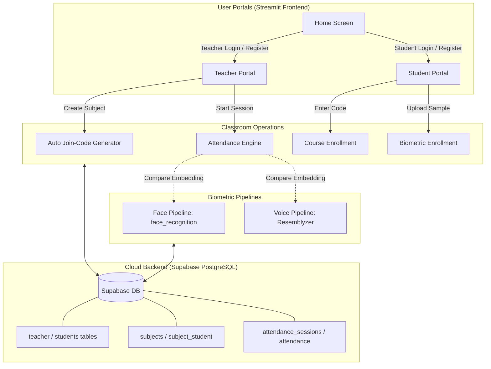

# QuickAttendance 📋

<div align="center">


### **Smart, Streamlined Classroom Attendance Management**
*An AI-ready attendance platform built with Streamlit and Supabase (PostgreSQL).*

[](https://www.python.org/)
[](https://streamlit.io/)
[](https://supabase.com/)
[](https://github.com/pyca/bcrypt)
[](#)

[Overview](#-overview) •
[Features](#-key-features) •
[Architecture](#-system-architecture) •
[Tech Stack](#-technology-stack) •
[Installation](#-installation--quickstart) •
[Supabase Setup](#-supabase-configuration) •
[Security](#-security--privacy)

</div>

---

## 📌 Overview

**QuickAttendance** eliminates cumbersome manual roll-calls and chaotic attendance tracking. Designed for academic and corporate classroom environments, it provides dedicated dashboards for instructors and students, automated enrollment via unique join codes, and modular support for multimodal biometric verification (Face & Voice recognition).

Whether running a lecture with hundreds of attendees or managing small lab batches, QuickAttendance offers instant visibility into attendance metrics while maintaining strict data isolation and privacy standards.

---

## ✨ Key Features

### 👨‍🏫 Teacher Portal
- **Subject Administration:** Create courses with automated 7-character collision-resistant join codes.
- **Roster Management:** View enrolled student profiles and monitor class capacity in real time.
- **Flexible Session Modes:**
  - ✍️ **Manual Checklist:** Quick per-student toggle with real-time status saving.
  - 📷 **Face Recognition:** Identifies enrolled students against 128-dimensional facial vector embeddings.
  - 🎙️ **Voice Recognition:** Speaker identification using acoustic voiceprint embeddings.
- **Historical Records:** Complete audit logs of past attendance sessions per subject with timestamping.

### 🎓 Student Portal
- **One-Click Enrollment:** Join classes instantly using the teacher's secret subject join code.
- **Enrolled Classes:** Browse all enrolled courses, instructor details, and sections.
- **Attendance Insights:** Personal attendance records and session timestamps.
- **Consent-Driven Biometrics:** Optional profile setup for face and voice biometrics with explicit user consent.

### 🌐 Companion Landing Site
- Lightweight Flask-powered landing page located in `landing/` with responsive CSS typography and call-to-action routing into the Streamlit app.

---

## 🏗️ System Architecture



---

## 🛠️ Technology Stack

| Component | Technology | Description |
|---|---|---|
| **Frontend Framework** | [Streamlit](https://streamlit.io/) | Interactive reactive web UI with custom modern typography |
| **Backend & Database** | [Supabase](https://supabase.com/) | Cloud PostgreSQL with Row Level Security (RLS) and indexing |
| **Security & Hashing** | [Bcrypt](https://pypi.org/project/bcrypt/) | Salted password hashing for credentials protection |
| **Data Manipulation** | [Pandas](https://pandas.pydata.org/) & [Pillow](https://python-pillow.org/) | Roster tables, dataframes, and image handling |
| **Biometric ML (Optional)** | `face-recognition`, `resemblyzer` | High-dimensional vector embeddings for facial and speaker identification |
| **Landing Site** | [Flask](https://palletsprojects.com/p/flask/) | Minimal companion landing page |

---

## 📂 Project Structure

```text
QuickAttendance/
├── .streamlit/
│   ├── config.toml               # Streamlit theme & server options
│   └── secrets.toml.example      # Template for Supabase credentials (never commit secrets.toml)
├── landing/                      # Lightweight standalone Flask landing site
│   ├── app.py
│   ├── requirements.txt
│   ├── static/css/style.css
│   └── templates/index.html
├── sql/
│   └── schema.sql                # Supabase PostgreSQL DDL schema with RLS policies
├── src/
│   ├── assets/                   # Brand logo and avatar illustrations
│   │   ├── logo.png
│   │   ├── student.png
│   │   └── teacher.png
│   ├── components/               # Modular UI components (headers, branding)
│   │   └── header.py
│   ├── database/                 # Supabase client connector and query helpers
│   │   ├── config.py
│   │   └── db.py
│   ├── pipelines/                # Modular biometric adapters
│   │   ├── face_pipeline.py      # Face embedding extraction & vector distance check
│   │   └── voice_pipeline.py     # Voice embedding extraction & cosine similarity
│   ├── screens/                  # Application views
│   │   ├── auth_screen.py        # Registration and authentication
│   │   ├── home_screen.py        # Portal selection cards
│   │   ├── student_screen.py     # Student dashboard & class attendance
│   │   └── teacher_screen.py     # Teacher management dashboard
│   └── ui/                       # Typography and base CSS stylesheets
│       └── base_layout.py
├── .gitignore                    # Security, virtual environment, and cache ignore rules
├── app.py                        # Streamlit application entry point
├── requirements.txt              # Production application dependencies
├── requirements-ml.txt           # Optional machine learning dependencies
└── README.md                     # Project documentation
```

---

## ⚡ Installation & Quickstart

### Prerequisites
- **Python 3.10+**
- Active **Supabase** account

### 1. Clone the Repository
```bash
git clone https://github.com/RajatBhardwaj2006/Quick-Attendance.git
cd Quick-Attendance
```

### 2. Set Up Virtual Environment

**Windows PowerShell:**
```powershell
python -m venv .venv
.\.venv\Scripts\Activate.ps1
```

**macOS / Linux:**
```bash
python3 -m venv .venv
source .venv/bin/activate
```

### 3. Install Dependencies
```bash
python -m pip install --upgrade pip
python -m pip install -r requirements.txt
```

---

## 🗄️ Supabase Configuration

QuickAttendance uses Supabase PostgreSQL for persistent storage.

1. Create a new project at [supabase.com](https://supabase.com).
2. Open the **SQL Editor** from the Supabase dashboard navigation.
3. Copy the contents of `sql/schema.sql` and execute the query to generate:
   - `teacher` & `students` tables
   - `subjects` & `subject_student` enrollment mappings
   - `attendance_sessions` & `attendance` audit records
   - Indices and Row Level Security (RLS) protections
4. Navigate to **Project Settings → API** to find your **Project URL** and **secret/service_role key**.
5. Copy the example configuration template:
   ```powershell
   Copy-Item .streamlit\secrets.toml.example .streamlit\secrets.toml
   ```
6. Edit `.streamlit/secrets.toml` with your real keys:
   ```toml
   SUPABASE_URL = "https://YOUR_PROJECT_ID.supabase.co"
   SUPABASE_SECRET_KEY = "YOUR_SUPABASE_SERVICE_ROLE_KEY"
   ```

> [!IMPORTANT]
> `.streamlit/secrets.toml` is ignored in `.gitignore`. **Never commit or share your real Supabase credentials.**

---

## 🚀 Running the Application

### Launch Streamlit Portal
```powershell
streamlit run app.py
```
Open your browser at `http://localhost:8501`.

### (Optional) Enable Face & Voice Recognition
```powershell
python -m pip install -r requirements-ml.txt
```
> [!NOTE]
> `face-recognition` requires `dlib` (which may require C++ CMake build tools on Windows). The core system operates completely without ML dependencies using manual session marking.

### (Optional) Run Companion Landing Page
```powershell
python -m pip install -r landing/requirements.txt
python landing/app.py
```
Visit `http://localhost:5000` to preview the promotional landing portal.

---

## 🔒 Security & Privacy

- **Data Minimization:** No biometric raw images or audio waveforms are permanently stored; only mathematical vector embeddings are kept when students opt-in.
- **Informed Consent:** Biometric enrollment tabs explicitly display clear consent notices before any vector capture.
- **Salted Password Hashing:** Bcrypt encryption protects all teacher and student authentication credentials.
- **Secure Configuration:** Zero secrets or sensitive keys are hardcoded in the codebase. All connection secrets are consumed via Streamlit's secrets manager.

---

## 📄 License

This project is licensed under the [MIT License](LICENSE) — feel free to use and adapt it for educational and non-commercial purposes.
